# Canon Engine v1 — architecture

## Layers

```mermaid
flowchart LR
  subgraph domain [src/domain — pure, no ST/Horae]
    pack[pack: schema + semantic lint, Graph A]
    time[time: ticks, bounds]
    red[reducer: facts, occurrences, dispositions]
    sch[schedule: crossed intervals, default adjudication, bootstrap]
    wq[world-query: identity, occurrence & entity indexes, causal closure, lexical search]
  end
  subgraph runtime [src/runtime — controller]
    rep[replay/reconcile]
    eng[engine: operation pipeline, journal, backup]
    pl[planner + impact + forced control]
    adj[adjudicator]
    ctx[context: retrieval + packet]
    gate[gate: deterministic validation + coverage]
    mdl[model: structured task runner]
  end
  subgraph adapters [src/adapters]
    st[ST: interceptor, quiet draft, raw tasks, prompt hooks, publish, verified save]
    hor[Horae read-only]
    lock[writer lock]
  end
  ui[src/ui]
  domain --> runtime --> adapters
  ui --> runtime
```



Graph A (pinned pack), the actual history ledger, Graph B (projection = reducer state over baseline + ledger) and future plans are separate types and namespaces. Indexes are rebuildable projections; the selected transcript + pinned pack + binding seed are the only authorities.

## Source of truth and replay

1. `readTranscript()` gives `[ {messageId, variantId, contentHash, role, text} ]` from `message.extra.canonEngine` ids (assigned once; duplicates from native copies get fresh ids). The hash covers role, author, text and attachments.
2. Each variant has stored **interpretations** (records, state claims, player actions with authorizing quotes, source dependencies, scene time, offscreen basis).
3. `replay()` applies bootstrap records, then each message's interpretation in order. Validity per message is checked deterministically: source dependencies and agency authorizations (always), presupposed state, duplicate canonical dispositions, offscreen precondition assumptions, time monotonicity, and whether it touches entities whose history changed earlier. An interpretation validated against the identical prefix state is reused (fast path) — still subject to the dependency check.
4. The first message without a valid interpretation is (re)interpreted by a model task against the new prefix (user: extraction; GM: discovery + retrieval + evaluator in `retained` mode). An incompatible retained message becomes an editorial **conflict**: its text is kept, generation pauses, nothing is invented to justify it.

Unchanged prefixes therefore replay with zero model calls; edits of either role at any position, deletions, swipe selection, reload and branch switches all reduce to "replay the selected transcript".

## One foreground operation

```mermaid
sequenceDiagram
  participant U as User (native Send/Swipe/Regenerate/Continue)
  participant ST as SillyTavern
  participant E as Engine
  participant M as Model (ST connection)
  U->>ST: native action
  ST->>E: GENERATION_STARTED (capture prior reply) / generate_interceptor
  E-->>ST: abort native generation
  E->>E: lock, settle, reconcile (rebuild dirty suffix), capture fences
  E->>E: Horae freshness barrier (wait / reanalyze / exclude)
  E->>M: plan (only when needed; ≤2 ordinary + 1 forced)
  E->>E: pre-generation retrieval (mentioned ∪ causal ∪ scene) → context packet
  E->>M: private draft (Generate quiet + engine context)
  loop initial + ≤2 repairs
    E->>M: whole-draft discovery
    E->>E: fresh retrieval over the full ledger (+ deterministic name/occurrence scan)
    E->>M: evaluator / final narrative review with fetched records
    E->>E: interval adjudication if the draft advances time (re-review with staged history)
    E->>E: deterministic gate + coverage manifest bound to the candidate hash
    E->>M: repair draft with violations + facts (if needed)
  end
  E->>E: fence check
  E->>ST: journal → saveReply (native events; Horae sees accepted text only) → verified save
  E->>E: apply delta, deterministic replay, save
  E->>M: impact assessment (post-commit; may mark plan stale / set banner)
```

## Retrieval (WORLD_STATE_CONTEXT_CONTRACT)

`retrieve()` builds the union of
- **mentioned** history: references from the user extractor / draft discovery resolved by exact identity (names, aliases, ids), occurrence reference phrases, lexical IDF search (words + CJK bigrams) and model-provided candidates from an occurrence catalogue; indirect person references resolve through matching occurrences to their actors;
- **causal** history: the records that established the current values of every relevant entity's facts, plus their transitive supported causes; parent/containment entities;
- **scene/entity constraints**: current facts with validity, support summary, explicit UNKNOWNs, uncertain transitions, parent constraints.

The packet gives the model record **content** (account, actors, actual outcome, causes, later changes, visibility/knowledge boundaries, evidence), canon statuses (`occurred/diverged/omitted/pending/future/unscheduled` — never presenting unfulfilled canon or plans as history), deviations, HARD obligations, ready plan steps, opportunities, and the exact player scope. Required sections are never truncated (compact mode first, then an explicit capacity error); optional sections are dropped first.

After generation the same retrieval runs again on the **whole candidate** (discovery + a deterministic floor: every known entity name and occurrence phrase in the text gets a lookup and an explicit review item). The evaluator receives this expanded context; every discovered claim needs a verdict; contradictions block; the coverage manifest is bound to the exact candidate hash, revision, scene checkpoint and staged overlay. Each repair repeats everything.

## Deterministic gate (summary)

Evidence quotes must exist in the candidate; entities/predicates/values are type-checked against pack + runtime registry (new entities get code ids; known identities cannot be renamed into new ones); time cannot move backwards outside flashbacks; HARD outcomes can only be produced by the HARD event's own occurrence with the exact required outcome inside its authored bounds and a reviewer-confirmed depiction; crossed HARD deadlines must be realized onscreen or by staged offscreen adjudication; ambiguous end times around a HARD checkpoint require a repair; narrated player actions need a verbatim authorizing quote from the user's message; presupposed state is checked at the claim's own checkpoint (flashback claims at their time), including containment in destroyed parents (partial damage does not imply destruction; explicit exceptions win); a claimed change cannot validate itself without its own occurrence; engine labels/JSON in prose are rejected; plan enactments need an occurrence and evidence.

## Planning and convergence

Rolling detailed plan for the next two pending HARD anchors plus any anchors flagged by impact; compact register for the rest. Replanning triggers: no plan, stale plan after a source change (revalidated by assumptions), a protected anchor's prerequisite truth value changed, an expired unenacted step, a protected anchor fulfilled, impact assessment (`replan` or non-local scope), or a diagnosed large-scale change (a `world` entity no longer exists while a protected anchor depends on it) which authorizes **forced convergence** directly. Otherwise forced mode is authorized only after validated ordinary proposals failed. Plans are validated (no dropped/renamed/rescheduled/weakened anchors, no alternate worlds, no player consent, times within bounds, effects consistent with anchor outcomes at their checkpoints, extraordinary means only in forced mode). Plans are intentions; they never change facts. HARD obligations are additionally enforced at their checkpoints by the gate/adjudicator even without a valid plan.

## Durable recovery boundary

ST and Horae are not one transaction. The guaranteed invariant: a rejected draft never enters chat, Horae, memory or the ledger. A commit writes a journal (with the full interpretation) into chat metadata before `saveReply`; ST persists chat + metadata in one file, so after a crash either the reply and its journal are durable together (journal finalized on next load) or neither is (journal discarded, regenerate prior restored). Native rendering callbacks (e.g. Horae's background analysis) may save the chat themselves; this is safe because they save the same in-memory chat/metadata. Saves are serialized through ST's own save path and verified by reading the file back; a failed save is reported (`unsaved`) and cleared only by a verified successful save.
