# Canon Engine — architecture

## Layers

```mermaid
flowchart LR
  subgraph domain [src/domain — pure, no ST/Horae]
    pack[pack: schema + semantic lint, Graph A]
    time[time: ticks, bounds]
    red[reducer: facts, occurrences, dispositions]
    sch[schedule: crossed intervals, default adjudication, bootstrap]
    wq[world-query: identity, occurrence & entity indexes, causal closure, lexical search]
  end
  subgraph runtime [src/runtime — controller]
    rep[replay/reconcile]
    eng[engine: operation pipeline, journal, backup]
    pl[planner + impact + forced control]
    adj[adjudicator]
    ctx[context: retrieval + packet]
    gate[gate: deterministic validation + coverage]
    mdl[model: structured task runner]
  end
  subgraph adapters [src/adapters]
    st[ST: interceptor, quiet draft, raw tasks, prompt hooks, publish, verified save]
    hor[Horae read-only]
    lock[writer lock]
  end
  ui[src/ui]
  domain --> runtime --> adapters
  ui --> runtime
```



Graph A (pinned pack), the actual history ledger, Graph B (projection = reducer state over baseline + ledger) and future plans are separate types and namespaces. Indexes are rebuildable projections; the selected transcript + pinned pack + binding seed are the only authorities.

## Source of truth and replay

1. `readTranscript()` gives `[ {messageId, variantId, contentHash, role, text} ]` from `message.extra.canonEngine` ids (assigned once; duplicates from native copies get fresh ids). The hash covers role, author, text and attachments.
2. Each variant has stored **interpretations** (records, state claims, player actions with authorizing quotes, source dependencies, scene time, offscreen basis).
3. `replay()` applies bootstrap records, then each message's interpretation in order, then any **manual records** the player added (*强制完成*) right after the message that was last when they were made (at the end if that message is gone). Validity per message is checked deterministically: source dependencies and agency authorizations (always), presupposed state, duplicate canonical dispositions, offscreen precondition assumptions, time monotonicity, and whether it touches entities whose history changed earlier. An interpretation validated against the identical prefix state is reused (fast path) — still subject to the dependency check.
4. The first message without a valid interpretation is (re)interpreted by a model task against the new prefix (user: extraction; GM: discovery + retrieval + evaluator in `retained` mode). An incompatible retained message becomes an editorial **conflict**: its text is kept, generation pauses, nothing is invented to justify it.

Unchanged prefixes therefore replay with zero model calls; edits of either role at any position, deletions, swipe selection, reload and branch switches all reduce to "replay the selected transcript".

## One foreground operation

```mermaid
sequenceDiagram
  participant U as User (native Send/Swipe/Regenerate/Continue)
  participant ST as SillyTavern
  participant E as Engine
  participant M as Model (ST connection)
  U->>ST: native action
  ST->>E: GENERATION_STARTED (capture prior reply) / generate_interceptor
  E-->>ST: abort native generation
  E->>E: lock, settle, reconcile (rebuild dirty suffix), capture fences
  E->>E: Horae freshness barrier (wait / reanalyze / exclude)
  E->>M: plan (only when needed; ≤2 ordinary + 1 forced)
  E->>E: pre-generation retrieval (mentioned ∪ causal ∪ scene) → context packet
  E->>M: private draft (Generate quiet + engine context)
  loop initial + ≤2 repairs
    E->>M: whole-draft discovery
    E->>E: fresh retrieval over the full ledger (+ deterministic name/occurrence scan)
    E->>M: evaluator / final narrative review with fetched records
    E->>E: interval adjudication if the draft advances time (re-review with staged history)
    E->>E: deterministic gate + coverage manifest bound to the candidate hash
    E->>M: repair draft with violations + facts (if needed)
  end
  E->>E: fence check
  E->>ST: journal → saveReply (native events; Horae sees accepted text only) → verified save
  E->>E: apply delta, deterministic replay, save
  E->>M: impact assessment (post-commit; may mark plan stale / set banner)
```

## Retrieval (WORLD_STATE_CONTEXT_CONTRACT)

`retrieve()` builds the union of
- **mentioned** history: references from the user extractor / draft discovery resolved by exact identity (names, aliases, ids), occurrence reference phrases, lexical IDF search (words + CJK bigrams) and model-provided candidates from an occurrence catalogue; indirect person references resolve through matching occurrences to their actors;
- **causal** history: the records that established the current values of every relevant entity's facts, plus their transitive supported causes; parent/containment entities;
- **scene/entity constraints**: current facts with validity, support summary, explicit UNKNOWNs, uncertain transitions, parent constraints.

The packet gives the model record **content** (account, actors, actual outcome, causes, later changes, visibility/knowledge boundaries, evidence), canon statuses (`occurred/diverged/omitted/pending/future/unscheduled` — never presenting unfulfilled canon or plans as history), deviations, HARD obligations, ready plan steps, opportunities, and the exact player scope. Required sections are never truncated (compact mode first, then an explicit capacity error); optional sections are dropped first.

After generation the same retrieval runs again on the **whole candidate** (discovery + a deterministic floor: every known entity name and occurrence phrase in the text gets a lookup and an explicit review item). The evaluator receives this expanded context; every discovered claim needs a verdict; contradictions block; the coverage manifest is bound to the exact candidate hash, revision, scene checkpoint and staged overlay. Each repair repeats everything.

## Deterministic gate (summary)

Evidence quotes must exist in the candidate; entities/predicates/values are type-checked against pack + runtime registry (new entities get code ids; known identities cannot be renamed into new ones); time cannot move backwards outside flashbacks; a near HARD event's exact required outcome (one of the next two pending HARD events or within 2 days; a real change, not the value already holding) can only be produced by that event's own occurrence inside its authored bounds with a reviewer-confirmed depiction — other values of the same fact are ordinary story; crossed HARD deadlines must be realized onscreen or by staged offscreen adjudication; an end-time range that reaches a HARD checkpoint the reply does not depict is taken as ending before it (its lower bound already lies before; the event stays due); narrated player actions need a verbatim authorizing quote from the user's message; presupposed state is checked at the claim's own checkpoint (flashback claims at their time), including containment in destroyed parents (partial damage does not imply destruction; explicit exceptions win); a claimed change cannot validate itself without its own occurrence; engine labels/JSON in prose are rejected; plan enactments need an occurrence and evidence.

## Planning and convergence

Rolling detailed plan for the next two pending HARD anchors plus any anchors flagged by impact; compact register for the rest. The planner also receives, as context only, the starting situation of non-HARD original events of the next 24 hours (so its steps do not make anyone act on knowledge they would not have yet, and secret HARD outcomes get routes out of public view) and the player's *关注* events, for which it may add up to two non-binding steps that give the player a chance to be present. Replanning triggers: no plan, stale plan after a source change (revalidated by assumptions), a protected anchor's prerequisite truth value changed, an expired unenacted step, a protected anchor fulfilled, impact assessment (`replan` or non-local scope), or a diagnosed large-scale change (a `world` entity no longer exists while a protected anchor depends on it) which authorizes **forced convergence** directly. Otherwise forced mode is authorized only after validated ordinary proposals failed. Plans are validated (no dropped/renamed/rescheduled/weakened anchors, no alternate worlds, no player consent, times within bounds, extraordinary means only in forced mode; an effect contradicts an anchor's outcome only when its step serves that anchor or is still running at its deadline — intermediate states before it are allowed; mistyped effects are repaired or dropped, and a forgotten protected-anchor id is added). Plans are intentions; they never change facts. HARD obligations are additionally enforced at their checkpoints by the gate/adjudicator even without a valid plan.

## Narrative integration (the world reacts to the player)

`src/runtime/integration.ts`. Campaigns bound from 1.4.0 read the standard Persona once (task `profile`) into a checked profile revision; its player/organization/place runtime entities enter history as a `persona_seed` manual record. A changed Persona is reported; the player updates the identity from the current position or keeps it, and older messages keep the revision they were written with (`profileAt`).

- **Shared player context** (`playerContext`): identity, organizations and places with their current state, connections, knowers with levels, the player's actual history (every occurrence with the player's entities, the ones with the candidates' people always kept) and decisions. The HARD planner gets it too (P0) and replans when `playerContextHash` changes.
- **Decisions and contacts** are records in the interpretation of their message (`engagement` on the player's message, `world_contact` on the reply), so replay handles edits, deletions, swipes, continues, branches and failed saves. `engagementView` gives the current stance per scope: joined/accepted/reopened lift a refusal of exactly that scope (an event joined lifts an arc refusal for that event only), a single act (`limited`) lifts nothing, a deferral ends at its time.
- **Suggestions** (`integrate`, run in parallel with the planner, cached by the hash of everything they depend on) are checked by `checkOpportunities` and filtered again by `selectOpportunity` against the current decisions. They are never history and are not PROPOSED ACTIONS (a time skip never executes them). 关注 and pack hooks are inputs of this task; the legacy GM lines remain for campaigns without integration and as a fallback, without declined events.
- **Review**: the reviewer receives the decisions, the offered contact and recent contacts; it records contacts and reports `engagement_pressure`, which the gate keeps out of its HARD-noise filter.

## SOFT / FREE events

Non-HARD canon is default history, never planned toward:

- **GM context.** Events whose window is open (and whose preconditions are not FALSE) are listed as under way. The `起因` part of the next 24 hours of non-HARD events is given as *where other characters stand*: what they know, want and are doing — explicitly not obligations, with an instruction not to steer toward them. Player-focused events (*关注*) get a section asking for natural in-world chances to be present, from 24 hours before their window until it ends; focus is removed once the event is settled or its window has passed.
- **Reviewer.** The non-HARD events open around the scene (`canon_events_now`) are always passed, so a depicted one is recorded with its id (occurred / diverged) instead of as an ordinary scene beat.
- **Settlement when the window closes.** Preconditions TRUE and no actual play involving the event's people since 2 days before its window → recorded deterministically along the original route (no model call). Play involved its people → the model judges it from that play (as written, diverged, omitted), falling back to the original route. A prerequisite that happened differently (`diverged`) makes `occurred` conditions UNKNOWN, so the model judges with the actual account of that prerequisite. Preconditions FALSE → omitted with the reason. HARD events are never omitted.
- **Force complete.** A manual record (`origin: intervention`, `override: true`) marks the event occurred with its effects and HARD outcomes, replacing an earlier disposition; active plans become stale.

## Story time

The clock moves only through time-advance records (scene end of an accepted reply) and never backwards. The reviewer estimates how long each reply takes; explicit times in the text win. With Horae installed and fresh, a new reply (not a swipe/regenerate/continue) starts no earlier than Horae's story time at the end of the previous reply, if that is later than the engine clock and at most 3 days ahead (`followHoraeTime`).

## Scene boxes

With scene grouping on, the reviewer may file a beat under the current box (`continues`). The gate enforces the box limits (at most 4 beats, 90 minutes, one place) whatever the reviewer says, and the graph splits older chains by the same limits. Canon events never continue a box.

## Durable recovery boundary

ST and Horae are not one transaction. The guaranteed invariant: a rejected draft never enters chat, Horae, memory or the ledger. A commit writes a journal (with the full interpretation) into chat metadata before `saveReply`; ST persists chat + metadata in one file, so after a crash either the reply and its journal are durable together (journal finalized on next load) or neither is (journal discarded, regenerate prior restored). Native rendering callbacks (e.g. Horae's background analysis) may save the chat themselves; this is safe because they save the same in-memory chat/metadata. Saves are serialized through ST's own save path and verified by reading the file back; a failed save is reported (`unsaved`) and cleared only by a verified successful save.
